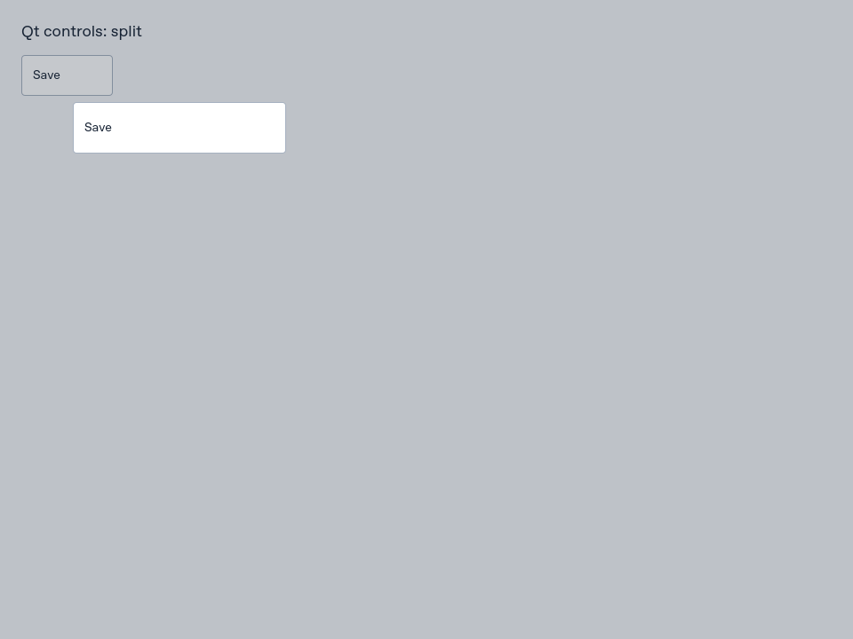
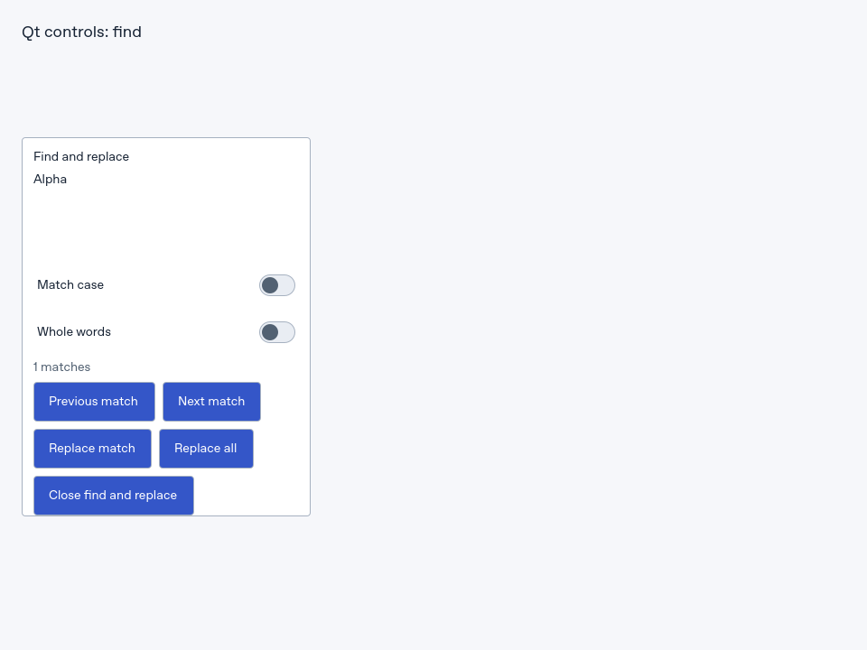

# Packaged Qt controls: executed host proof

**Both target bundles passed all 39 ordered input/check steps** using the
production Qt Quick/Fabric host and Hermes on Linux. The fixture imports nine
public controls from real extracted NYC-Tron archives. QNX and Marathon each
have a complete execution log, checked native target identity and retained
screenshots. Physical QNX and Marathon device acceptance remains unverified.

## What ran

| Item | Exact evidence |
| --- | --- |
| NYC-Tron source | [`eb1f473d910b0b13854778e60c6e7c41b41ff228`](https://github.com/mikevocalz/NYC-Tron-UI/commit/eb1f473d910b0b13854778e60c6e7c41b41ff228), tree `e70358de4d140ac78ee3a75ca1567af39442548e` |
| RN-QNX implementation | [`92e88b9111b29c9090f9bac63b906dad4cf10f74`](https://github.com/mikevocalz/react-native-qnx/commit/92e88b9111b29c9090f9bac63b906dad4cf10f74), tree `b4f17941d911f1e57f12667681c73345e3906fc8` |
| Native runner | `rnqnx_qt_controls_consumer`, desktop input and platform services enabled |
| Native binary SHA-256 | `5e2402d0b40e30d77db85c24f14138ca150ab556fb59ab2be7de8540003a9706` |
| Public app | `RNQnxQtControlsProbe`; actual `Platform.OS` checked as `qnx` or `marathon` |
| Host/input | Linux, 960 × 720 viewport, synthetic Qt mouse/key/focus input through the native event path |
| Package cohort | [Thirteen rebuilt archive checksums](packed-release-cohort-2026-11-10.json); the fixture consumes the real core, UI and Expo-controls archives |
| Result | QNX 39/39; Marathon 39/39 |

The [machine-readable execution receipt](evidence/qt-fabric-host-2026-11-10/receipt.json)
includes every ordered step, log and screenshot checksum, fixture/theme hashes,
archive hashes, and native runner source/binary identities. Its source binding
is distinct from the [frozen named-API profile](react-native-api.json): the
PublicAPI bytes and 30 named exports still match that reviewed profile.
The final RN repository evidence is published at
[`7bcf597047ddc493d1299a862ee7ab116293638f`](https://github.com/mikevocalz/react-native-qnx/blob/7bcf597047ddc493d1299a862ee7ab116293638f/docs/evidence/qt-controls-host-2026-11-10.json),
with the recorded implementation revision preserved in its ancestry.

| Production Metro bundle | Bytes | SHA-256 |
| --- | ---: | --- |
| QNX | 1,913,740 | `c2c352e33bd2c6756be2f3fd757271466dfe1e8d5f2d2cb312a12225ef08a93a` |
| Marathon | 1,913,792 | `2af1fd7c121596983492760065e988beaecc410c98564194b45bb09c67458d3d` |

Both bundles resolved without warnings through the actual target Metro
configuration and patched RN public entry. Their generated
[bundle receipt](packed-controls-probe-2026-11-10.json) records bundling alone;
the separate execution receipt establishes the native runs on those exact
bytes.

## Observed control behavior

| Public control | Assertions passed in both runs |
| --- | --- |
| Tooltip | Native hover and focus open the measured hint; Escape dismisses it; pointer leave and focus changes follow the lifecycle. |
| Select | Arrow keys open and skip the disabled choice; Enter commits once; reopening and Escape preserve selection; Qt exposes the named native list role. |
| NativeDropdown | A native pointer click opens the grouped list; End and Enter commit the final choice. |
| NativeActionMenu | Pointer opening delivers automatic focus; Qt reports the menu-item role and checked state; Enter dispatches exactly one callback and closes. |
| NativeSliderField | Home commits 0, ArrowRight commits 1, and End commits 100 through the controlled commit callback. |
| NativeSplitButton | The primary action stays separate; ArrowDown opens a visible modal menu outside the clipped button; automatic focus and Enter dispatch its action once. |
| ContextMenu | The native Menu key opens its actions; automatic focus and Enter select once and dismiss. |
| NativePopover | Opening and controlled reopening deliver automatic focus; Escape and the actual close control each request dismissal. |
| FindReplacePopover | The supplied literal search provider executes against the actual document; the surface receives automatic focus and Escape closes it. |

The driver waits for native visibility, focus and accessibility conditions
before proceeding. It polls the controlled React outcomes after input. Calls
from the runner only mount the next stage or change controlled props; they do
not invoke a component event handler directly. The complete logs retain all
native output, including RN informational/teardown messages:
[QNX log](evidence/qt-fabric-host-2026-11-10/qnx.log) and
[Marathon log](evidence/qt-fabric-host-2026-11-10/marathon.log).

## Rendered frames

The split-menu frame shows the modal surface escaping its clipped trigger
container. The find/replace frame shows the real shared content and literal
provider result under the explicit acceptance theme.





Tooltip, checked action-menu, split-menu and find/replace frames for both
targets are retained in the [evidence directory](evidence/qt-fabric-host-2026-11-10).

## Scope and reproduction

`tooling/qt-probe-theme.js` is a finite app-owned token/style adapter for this
fixture. It uses actual RN primitives and preserves explicit styles. The
fixture establishes these interaction and native accessibility observations
under those styles; broader Uniwind compilation, app appearance, spoken output,
physical target devices and optional provider/engine workflows retain their
own acceptance requirements. Every row of the 341-capability source map still
has `runtimeAcceptance: unverified`, and both runtime-accepted totals remain 0.

The full merged-source suite passed 1,227 tests. All thirteen shared packages
built and packed, with 619 checked public subpaths, 3,306 reachable declarations
and 753 ESM files. The source cohort includes the current completion base, the
native role corrections and the Android/iOS CI follow-ups; mobile CI outcomes
remain separate from this Linux host proof.

Build the shared archives and both fixture bundles with:

```sh
corepack pnpm -r --if-present build
node tooling/pack-release.mjs /absolute/path/to/new-packs
node tooling/qt-component-consumer.mjs /absolute/path/to/new-packs /absolute/path/to/react-native-qnx /absolute/path/to/new-render-consumer --render-probe
```

Run each resulting bundle with the native consumer built from the recorded RN
implementation and its matching target identity. The RN repository's
`tests/qt-controls-consumer` target owns the Qt event driver; this repository
owns the public packaged fixture and its asserted controlled outcomes.
